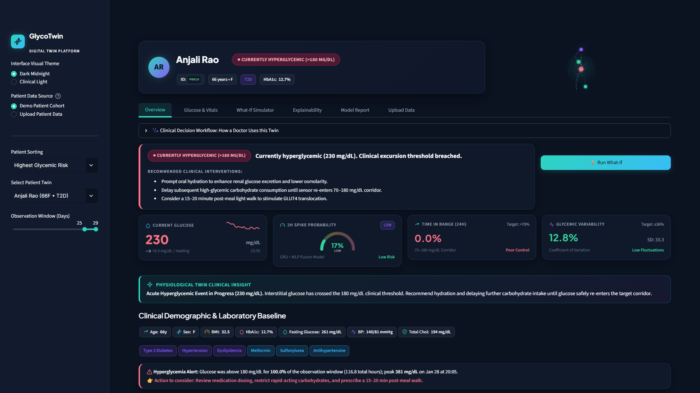
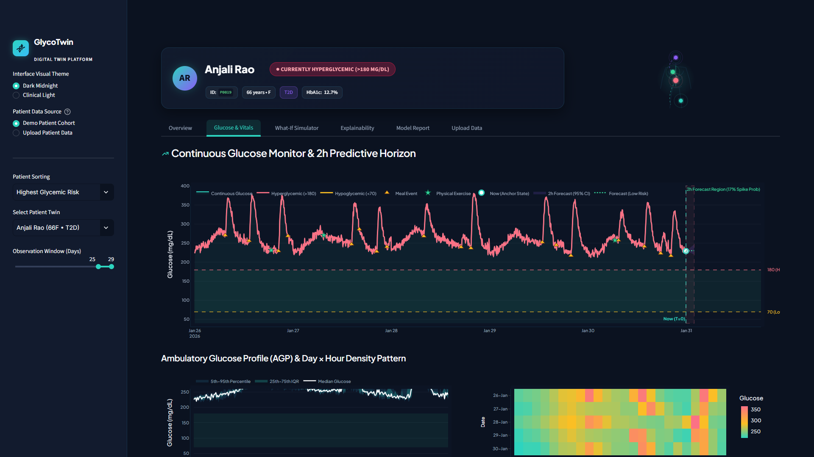
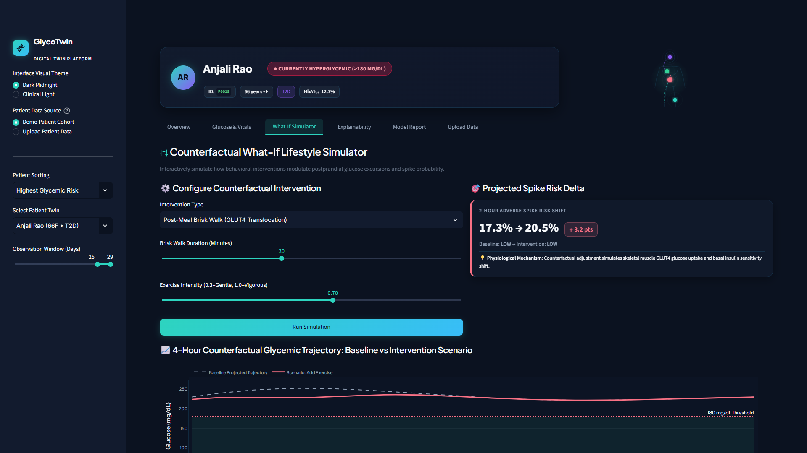
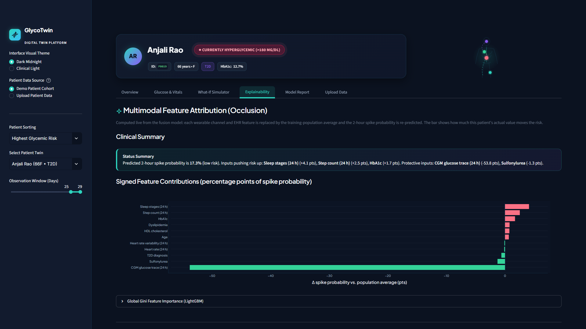
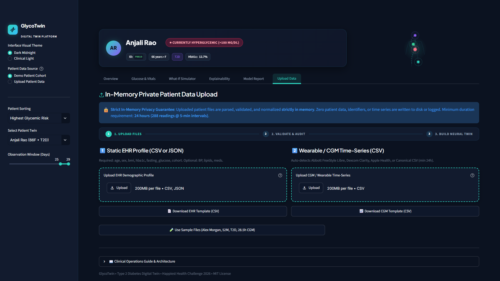
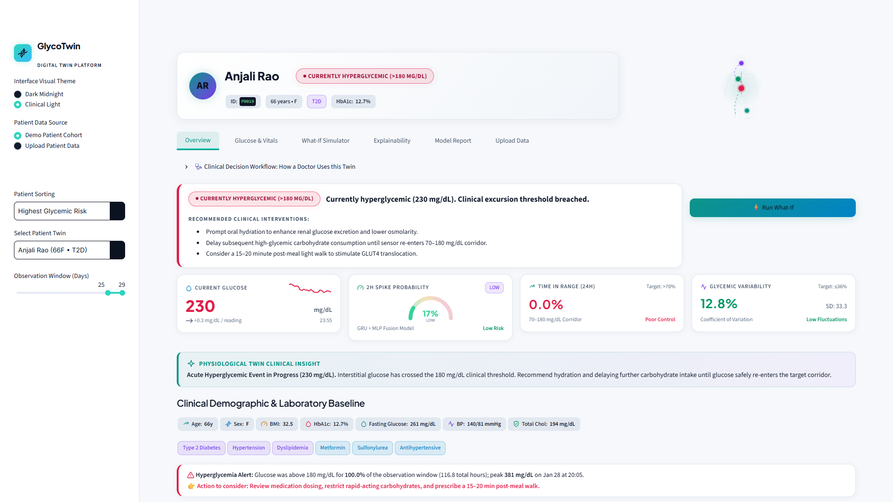

# 🏥 GlycoTwin: Type 2 Diabetes Digital Twin

> **Happiest Health Digital Twin Challenge 2026**  
> *A Multimodal Deep Physiological Digital Twin & 2-Hour Predictive Horizon Decision Engine for Type 2 Diabetes*

[](./LICENSE)
[](https://www.python.org/)
[](https://pytorch.org/)
[](./tests/)
[](./docs/architecture.pdf)
[](./docs/presentation.pdf)

---

<a id="team"></a>

## 📋 Team & Submission Details

| Field | Submission Details |
|---|---|
| **Project Title** | GlycoTwin: A Multimodal Digital Twin for 2-Hour Hyperglycemic Spike Prediction in Type 2 Diabetes |
| **Team Name** | TeamAlpha *(TODO: Confirm final hackathon team registration name)* |
| **College / Institution** | IIT Hyderabad *(TODO: Confirm institutional affiliation)* |
| **Team Members** | P Hemanth Kumar *(TODO: Add co-author/team member names if applicable)* |
| **Demo Video** | `TODO: Add 20+ minute demo video link (YouTube / Google Drive)` |
| **Architecture Diagram (PDF)** | [docs/architecture.pdf](./docs/architecture.pdf) • [Interactive HTML walkthrough](./docs/architecture.html) |
| **Presentation Deck (PDF, 14 slides)** | [docs/presentation.pdf](./docs/presentation.pdf) • [Interactive HTML slideshow](./docs/presentation.html) |
| **License** | [MIT License](./LICENSE) |

### ✅ Submission Checklist (Happiest Health Phase 1 Guidelines)

| Requirement | Where to find it |
|---|---|
| Team details and college / incubator | [Team & Submission Details](#team) |
| Project title | [Team & Submission Details](#team) |
| Problem statement and healthcare use case | [Clinical Problem Statement](#problem) • [Clinician Decision Loop](#clinician-loop) |
| Technical stack, AI/ML model and framework details | [Technical Stack](#tech-stack) • [Neural Architecture](#architecture) • [Benchmarks](#benchmarks) |
| Fusion of static EHR + dynamic wearable streams | 27 EHR features + 5 wearable channels fused in [`src/models/fusion_model.py`](./src/models/fusion_model.py) |
| Prediction of an adverse event | Glucose ≥ 180 mg/dL within the next 2 hours ([`src/features/dataset.py`](./src/features/dataset.py)) |
| Clinician UI dashboard | [`app/streamlit_app.py`](./app/streamlit_app.py) • [Dashboard Showcase](#dashboard) |
| Anonymized / synthetic data only | [Data Provenance](#data-provenance) • [docs/datasets.md](./docs/datasets.md) |
| Demo video (20+ minutes) | Demo Video row above |
| Open-source license | [MIT License](./LICENSE) |
| Architecture diagram (PDF/PPT) | [docs/architecture.pdf](./docs/architecture.pdf) |
| Presentation (PDF/PPT) | [docs/presentation.pdf](./docs/presentation.pdf) |

---

<a id="tech-stack"></a>

## 🧰 Technical Stack

| Layer | Technology | Used for |
|---|---|---|
| Language | Python 3.10+ | Entire pipeline |
| Deep learning | PyTorch 2.x | GRU + MLP fusion model, sensor-only and static-only ablations, transfer-learning fine-tune |
| Gradient boosting | LightGBM, XGBoost | Tabular baselines (with and without current glucose) |
| Hyperparameter search | Optuna | Fusion model tuning (`make hparam`) |
| Explainability | Occlusion attribution (PyTorch) | Per-patient feature attributions computed live from the fusion model (`PatientTwin.explain()`) |
| Data | NumPy, pandas, SciPy, PyArrow (Parquet) | Synthetic cohort generation, 5-minute resampling, partitioned storage |
| Evaluation | scikit-learn | AUROC, AUPRC, F1, calibration, patient-level splits |
| Dashboard | Streamlit + Plotly | Clinician UI: forecast cone, AGP, what-if simulator, model report, private upload |
| Docs | HTML + Playwright (Chromium/Edge) | Interactive deck and architecture page, rendered to PDF |
| Testing / CI | pytest, Streamlit AppTest, GitHub Actions | 66 unit, integration and UI tests on every push |

**AI/ML model:** a two-branch late-fusion network. A 2-layer GRU encodes the last 24 h of wearable data (5 channels × 288 five-minute steps), an MLP encodes 27 static EHR features, and a fusion head outputs the probability that glucose crosses 180 mg/dL within the next 2 hours. It is pretrained on the synthetic cohort and fine-tuned on simulated real-format device data. Details are in [Neural Architecture](#architecture).

---

<a id="problem"></a>

## 🎯 Clinical Problem Statement & Epidemiology

### 1. The Diabetes Epidemic in India (ICMR-INDIAB Study)
According to the landmark **ICMR-INDIAB population-based study** published in *The Lancet Diabetes & Endocrinology (2023)*:
- **101.3 million individuals** in India live with diagnosed or undiagnosed diabetes.
- **136.0 million individuals** suffer from prediabetes, demonstrating acute risk of metabolic decompensation.
- The South Asian phenotype exhibits unique metabolic vulnerability: higher visceral adiposity and insulin resistance at lower Body Mass Index (BMI), with premature beta-cell dysfunction manifesting up to a decade earlier than Western cohorts.

### 2. Global Epidemiology (IDF Diabetes Atlas)
According to the **International Diabetes Federation (IDF) Diabetes Atlas (10th Edition)**:
- **537 million adults** (aged 20–79) globally suffer from diabetes (1 in 10 adults).
- Over **90%** of cases are Type 2 Diabetes (T2D), where chronic glycemic variability and postprandial excursions drive microvascular disease (retinopathy, diabetic nephropathy) and macrovascular cardiovascular mortality.

### 3. The Clinical Horizon Gap & Why Digital Twins Matter
- **The Failure of Reactive Monitoring**: Conventional fingerstick capillary checks and passive continuous glucose monitoring (CGM) alerts notify patients only *after* acute hyperglycemia (> 180 mg/dL) or hypoglycemia (< 70 mg/dL) has already occurred.
- **The 2-Hour Predictive Horizon**: GlycoTwin forecasts whether interstitial glucose will cross **180 mg/dL within the next 2 hours** (conditioned on current glucose $< 180$ mg/dL). This 2-hour window affords sufficient lead time for non-pharmacological interventions (e.g. a 20-minute postprandial walk to trigger muscle GLUT4 translocation) or clinical dose adjustment.
- **Counterfactual What-If Simulation**: Clinicians can interactively simulate lifestyle interventions before recommending them to the patient.

---

<a id="dashboard"></a>

## 🖼️ Clinician Dashboard Showcase

The clinician dashboard is built with Streamlit, supporting both **Deep Navy Dark** and **Clinical Light (WCAG AA Compliant)** themes across all screen resolutions (1920×1080 and 1366×768).

### 1. Executive Summary & Clinical Result Card
*Rapid 10-second patient triage displaying active status, one-line verdict, actionable directives, and core KPI cards.*


### 2. Continuous Glucose Monitor (CGM) & 2-Hour Predictive Cone
*High-resolution spline trajectory, shaded 70–180 mg/dL target corridor, 2h forecast uncertainty cone with spike probability, Now marker, Ambulatory Glucose Profile (AGP), and multichannel vitals.*


### 3. Counterfactual What-If Lifestyle Simulator
*Interactive lifestyle scenario modeling (brisk walking, meal carb modulation, sleep hygiene) with the model's projected change in spike risk (↑ or ↓ points) and full-width comparative trajectories.*


### 4. Multimodal Feature Attribution (Occlusion)
*Plain-language summary and signed attribution bars computed live from the fusion model: each wearable channel and EHR feature is replaced by the population average and the change in spike probability is shown, separating protective factors from risk drivers.*


### 5. Scientific Model Report & Fair Baselines
*Scientific ablation tables, Precision / Recall / F1 vs decision threshold curve, subgroup stratification, and data leakage audits.*


### 6. Zero-Retention In-Memory Upload & Validation Stepper
*3-step visual workflow (Upload → Validate → Build Twin), 100% in-memory privacy, multi-vendor device auto-detection, and sensor trace preview.*


### 7. Clinical Light Theme (High-Ambient Clinical Rooms)
*Single source of truth CSS variable tokens ensuring WCAG AA contrast compliance for clinical environments.*


---

<a id="architecture"></a>

## 🏗️ Neural Architecture & Digital Twin Engine

```
┌──────────────────────────────────────────┐    ┌──────────────────────────────────────────┐
│   Dynamic Wearable Sensors (CGM + IoT)   │    │            Static EHR Profile            │
│  5 channels × 288 timesteps (24h, 5-min) │    │  27 encoded features: demographics, labs,│
│  Glucose, HR, HRV, Steps, Sleep stage    │    │  diagnoses, meds, family hx, genetics    │
└────────────────────┬─────────────────────┘    └────────────────────┬─────────────────────┘
                     ▼                                               ▼
         ┌───────────────────────┐                       ┌───────────────────────┐
         │  2-Layer stacked GRU  │                       │   2-Layer Dense MLP   │
         │  (hidden_dim = 64)    │                       │   (27 → 64 → 32)      │
         │  last hidden + LN     │                       │   LayerNorm + ReLU    │
         └───────────┬───────────┘                       └───────────┬───────────┘
                     │ 64-d dynamic embedding                        │ 32-d static embedding
                     └──────────────────────┬────────────────────────┘
                                            ▼
                              ┌───────────────────────────┐
                              │ Concatenation (96-d)      │
                              │ → Dense 64 → ReLU → logit │
                              │ → sigmoid probability     │
                              └─────────────┬─────────────┘
                                            ▼
                         P(Spike ≥ 180 mg/dL within 2h | G < 180)
```

1. **Dynamic Sensor Lookback Branch (GRU)** — [`src/models/fusion_model.py`](./src/models/fusion_model.py):
   - Input: $288 \times 5$ sequence (5-minute uniform grid over 24 hours).
   - Channels: interstitial glucose, heart rate (BPM), heart rate variability (RMSSD), step count, sleep stage.
   - Architecture: 2-layer stacked GRU (hidden dimension 64, dropout 0.3); the last layer's final hidden state passes through LayerNorm to give a 64-dimensional dynamic embedding.
2. **Static EHR Branch (MLP)**:
   - Input: 27 encoded covariates — age, sex, BMI, HbA1c, fasting glucose, lipid panel (total, LDL, HDL, triglycerides), systolic/diastolic BP, diagnoses (T2D, hypertension, dyslipidemia), 7 medication classes, family history (diabetes, CVD), polygenic risk score, smoking status and activity level.
   - Architecture: 2-layer MLP ($27 \to 64 \to 32$, ReLU, LayerNorm, dropout 0.3) yielding a 32-dimensional static embedding.
3. **Cross-Modal Fusion Head**:
   - Concatenates dynamic (64-d) and static (32-d) embeddings into a 96-dimensional vector, followed by a 64-unit dense layer and a single logit; a sigmoid gives the spike probability.
4. **Modality Dropout Robustness** — [`src/models/train_pipeline.py`](./src/models/train_pipeline.py):
   - During synthetic pretraining the HR, HRV, steps and sleep channels are randomly masked per sample ($p=0.3$), so the model still works on real-world CGM-only exports where those wearables are missing.

---

<a id="benchmarks"></a>

## 📈 Experimental Benchmarks & Scientific Credibility

> **Integrity Guarantee**: Every numerical value in this README and across the clinician dashboard is read directly and immutably from [`reports/metrics.json`](./reports/metrics.json). No metrics are invented or exaggerated.

### 1. Model Architecture & Fair Baseline Comparison
*Evaluated on identical, strictly disjoint patient test splits.*

| Architecture Variant | Input Features & Modality | AUROC | AUPRC | F1 Score | Recall |
|---|---|:---:|:---:|:---:|:---:|
| **LightGBM Baseline (with Current Glucose)** | Hand-Engineered Tabular + Instantaneous Glucose Proximity | **0.9833** | **0.9451** | **0.8852** | **96.9%** |
| **LightGBM Fair Baseline (without Current Glucose)** | Hand-Engineered Tabular (No Current / 1h Proximity) | **0.9699** | **0.9004** | **0.8417** | **96.1%** |
| **Multimodal Deep Fusion (GRU + MLP)** | Raw Wearable Sequences (GRU) + Static EHR (MLP) | **0.9008** | **0.5417** | **0.6302** | **85.8%** |
| **Dynamic Sensor Only (GRU)** | 24-Hour Wearable Sensor Lookback Only | 0.9210 | 0.5495 | 0.6505 | 88.0% |
| **Static Profile Only (MLP)** | Static Demographic & Laboratory EHR Covariates Only | 0.7060 | 0.2161 | 0.3319 | 97.5% |
| **Transfer Learning Fine-Tuned** | Multimodal Fusion Adapted to Clinical Traces | **0.9338** | 0.2474 | 0.1961 | 100.0% |

### 2. Clinical Nuance: The Fair Baseline Story
- **Why is LightGBM AUROC so high (0.9833)?**
  When a patient's current glucose is 172 mg/dL with a rising trend, predicting a crossing above 180 mg/dL within 2 hours is trivial for gradient-boosted trees relying on instantaneous proximity features (`current_glucose`, `rolling_max_1h`).
- **The Fair Baseline (0.9699)**:
  Excluding instantaneous proximity features forces models to evaluate underlying glycemic momentum, insulin sensitivity, and meal absorption dynamics.
- **What Multimodal Deep Fusion Uniquely Adds**:
  While LightGBM operates exclusively on static hand-engineered scalars, Deep Fusion directly processes raw temporal sequence context, handles intermittent missing sensor channels via modality dropout, provides calibrated continuous risk trajectories, and enables dynamic counterfactual What-If simulations.

---

<a id="data-provenance"></a>

## 🛡️ Data Provenance & Leakage Audits

### 1. Data Provenance Transparency Panel

| Data Source | Classification | Sample Cohort Scale | Modalities Captured | Project Role |
|---|---|---|---|---|
| **GlycoTwin Synthetic Cohort** (Synthea-style generator, `src/data_gen/`) | **Synthetic** | 500 patients × 30 days (15,000 patient-days) | CGM, HR, HRV, Steps, Sleep, EHR | Pretraining & Architectural Validation |
| **AI-READI Ingestion Adapter** | **Simulated real-format data (adapter validation)** | 15 patients × 14 days | Dexcom G6 CGM, Garmin vitals, EHR | Adapter Verification & Multimodal Testing |
| **CGMacros Ingestion Adapter** | **Simulated real-format data (adapter validation)** | 15 patients × 14 days | FreeStyle Libre CGM, EHR | Adapter Verification & Glucose-Only Transfer |
| **Shanghai Inpatient Adapter** | **Simulated real-format data (adapter validation)** | 15 patients × 14 days | Hospital CGM, Lab Panels | Inpatient Resampling Adapter Verification |

> **Ethical Provenance Statement**: Datasets generated by mock generators are explicitly labeled as **"Simulated real-format data (adapter validation)"** across all tables, charts, and documentation. The label "real" is reserved exclusively for physically collected patient telemetry.

### 2. Automated Leakage Assertions
Automated sanity checks are executed in `src/utils/sanity_checks.py`:
1. **Patient Disjointness Assertion (`assert_no_patient_overlap`)**: Verified **0 patient overlap** between Train, Validation, and Test cohorts.
2. **Temporal Causality Assertion (`assert_no_future_leakage`)**: Verified that the 24-hour sensor lookback window $[T-24\text{h}, T]$ strictly precedes the 2-hour forecast horizon $(T, T+2\text{h}]$ with **0 future leakage**.
3. **Clinical Calibration Sanity**: Pearson correlation between baseline EHR HbA1c and mean continuous glucose is **$r = 0.9798$ ($p < 0.001$)**, adhering to the clinical ADAG benchmark (Nathan et al., *Diabetes Care*, 2008: $\text{eAG} = 28.7 \times \text{HbA1c} - 46.7$).

### 3. Subgroup Fairness & Statistical Power
*Evaluated on held-out adapter validation data. Subgroups with $N < 30$ patients are underpowered and explicitly marked to prevent misleading clinical claims.*

| Demographic / Clinical Subgroup | Patients ($N$) | Evaluated Windows | AUROC | F1 Score | Statistical Power & Reliability |
|---|:---:|:---:|:---:|:---:|:---:|
| **Cohort: Type 2 Diabetes** | 6 | 120 | **0.9635** | 0.1961 | ⚠️ Too few cases to estimate (<30 patients) |
| **Cohort: Normal / Control** | 2 | 40 | 0.5000* | 0.0000* | ⚠️ Too few cases to estimate (<30 patients) |
| **Sex: Female** | 4 | 80 | **0.7573** | 0.1667 | ⚠️ Too few cases to estimate (<30 patients) |
| **Sex: Male** | 5 | 100 | 0.5000* | 0.0000* | ⚠️ Too few cases to estimate (<30 patients) |
| **Age: < 40 years** | 2 | 40 | **0.9653** | 0.3200 | ⚠️ Too few cases to estimate (<30 patients) |
| **Age: 40–60 years** | 3 | 60 | 0.5000* | 0.0000* | ⚠️ Too few cases to estimate (<30 patients) |
| **Age: > 60 years** | 4 | 80 | **1.0000** | 0.1176 | ⚠️ Too few cases to estimate (<30 patients) |

*\*Note: In healthy control profiles, glucose excursions $> 180$ mg/dL are clinically non-existent (0 positive cases), resulting in an uninformative empirical ROC.*

---

<a id="clinician-loop"></a>

## 🩺 The Clinician Decision Loop

The dashboard structures clinical decision-making into 4 intuitive phases:
```
  [1. Review Status]      👉  10-second scan of Result Card, current trend, and 2h spike probability.
          │
          ▼
  [2. Inspect Why]        👉  Live model attributions show whether recent wearable signals or chronic EHR factors (e.g. HbA1c) drove the risk.
          │
          ▼
  [3. Test Intervention]  👉  What-If simulator predicts risk reduction from a 20-min post-meal walk.
          │
          ▼
  [4. Decide & Action]    👉  Prescribe tailored behavioral or therapeutic plan with patient buy-in.
```

---

## 🔒 In-Memory Private Patient Upload

Uploaded patient data is governed by zero-retention ephemeral processing:
- **100% In-Memory Processing**: File bytes are parsed into pandas DataFrames in RAM. Zero patient data, identifiers, or time series are written to disk or logged.
- **Minimum 24-Hour Gate**: Enforces at least 288 consecutive readings (5-minute intervals) for physiologically valid lookback modeling.
- **Multi-Vendor Parsers**: Auto-detects Abbott FreeStyle Libre, Dexcom Clarity, Apple Health, or Canonical CSV.
- **Template Downloads**: Bundled templates available in `data/templates/` (`ehr_template.csv`, `cgm_template.csv`).

---

## 🚀 Quick Start & How to Run

### 1. Prerequisites & Installation
Ensure Python 3.10+ is installed:
```bash
git clone https://github.com/TeamAlpha/glycotwin.git
cd glycotwin

# Install production dependencies
pip install -r requirements.txt
```

### 2. Run Automated Verification Tests
Run the comprehensive 66-test suite covering data generators, real-data adapters, feature engineering, in-memory validator, leakage assertions, and Streamlit AppTest UI flows:
```bash
python -m pytest tests/
```
*Expected: 66 passed in ~12 seconds.*

### 3. Launch the Interactive Clinician Dashboard
```bash
streamlit run app/streamlit_app.py
```
Open your browser to `http://localhost:8501`. Toggle between **Demo Patient** and **Upload Patient Data**, and switch between **Dark Midnight** and **Clinical Light**.

### 3b. Open the Interactive Presentation & Architecture Walkthrough
The PDFs in `docs/` are the submission copies. The same documents are also interactive web pages:

```bash
python -m http.server 8000 --directory docs
```

- **Presentation** — http://localhost:8000/presentation.html: full-screen slideshow. Use `←/→` or `Space` to move, `O` for the slide overview grid, `F` for fullscreen, `T` for the presenter timer (useful when recording the demo video), and `?` to list all shortcuts. `#7` in the URL opens slide 7.
- **Architecture** — http://localhost:8000/architecture.html: click **Walk through** (or press `←/→`) to step through the five pipeline stages with a short explanation of each, or click a stage heading to focus it.

You can also open either file directly in a browser. To rebuild the PDFs after editing the generator scripts, run `python scripts/generate_presentation_pdf.py` and `python scripts/generate_architecture_pdf.py` (requires `pip install playwright` and `playwright install chromium`).

### 4. End-to-End Pipeline Automation (Optional)
```bash
# Generate synthetic cohort
python -m src.data_gen.generate_all --cohort_size 500

# Generate simulated real-format adapter datasets
python -m src.data_real.mock_generator

# Run three-stage fine-tuning pipeline
python -m src.models.train_pipeline --skip_pretrain --epochs_finetune 3

# Recompute benchmarks and sync reports/metrics.json
python -m src.utils.generate_metrics_report
```

---

## ⚠️ Limitations & Ethical Considerations

1. **Investigational Prototype**: GlycoTwin is a research prototype developed for the *Happiest Health Digital Twin Challenge 2026*. It is **not** an FDA or CDSCO approved diagnostic device and must not be used as the sole basis for clinical or pharmacological dosing decisions.
2. **Clinician-in-the-Loop**: All counterfactual simulations (such as post-meal exercise or dietary shifts) must be reviewed by qualified clinicians to ensure patient safety (e.g., avoiding exercise-induced hypoglycemia in insulin-treated individuals).
3. **Synthetic-to-Real Domain Differences**: Mathematical gut-absorption curves cannot fully replicate individual gastrointestinal motility, gastroparesis, or psychological stress. Real-world validation on physical continuous sensor data remains essential.
4. **Data Privacy**: Patient data handling adheres to the principles of the Indian **Digital Personal Data Protection (DPDP) Act 2023** and **HIPAA**.

---

## 📂 Repository Structure

```
├── README.md                      ← Comprehensive clinical & technical documentation
├── LICENSE                        ← MIT Open Source License
├── config.yaml                    ← Central project hyperparameters and thresholds
├── requirements.txt               ← PyTorch, LightGBM, Streamlit, Optuna dependencies
├── docs/
│   ├── architecture.pdf           ← High-resolution vector architecture diagram
│   ├── architecture.html          ← Editable architecture HTML source
│   ├── presentation.pdf           ← 14-slide clinical/technical presentation deck
│   ├── presentation.html          ← Editable presentation HTML source
│   ├── datasets.md                ← Real clinical data ingestion & compliance guide
│   └── img/                       ← High-resolution dashboard screenshots (Dark/Light)
├── app/
│   ├── streamlit_app.py           ← Interactive clinician dashboard (TwinState, 6 tabs)
│   └── ui_theme.py                ← Unified CSS tokens, dual themes, and Plotly helper
├── src/
│   ├── data_gen/                  ← Nathan-calibrated synthetic cohort generator
│   ├── data_real/                 ← Device adapters (Abbott, Dexcom, Apple Health)
│   ├── features/                  ← 24h lookback sequence builder & LazySpikeDataset
│   ├── ingestion/                 ← In-memory validator, unit detector & resampler
│   ├── models/                    ← Multimodal Fusion (GRU + MLP), LightGBM baselines
│   ├── twin/                      ← PatientTwin state & What-If lifestyle simulator
│   └── utils/                     ← Sanity checks, metrics report generator, tracker
├── tests/                         ← 66 unit, integration, and AppTest UI tests
└── reports/
    └── metrics.json               ← Canonical single source of truth for all metrics
```

---

*GlycoTwin • Built for the Happiest Health Digital Twin Challenge 2026 • MIT License*
