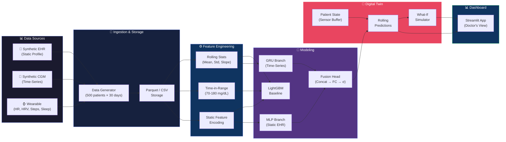
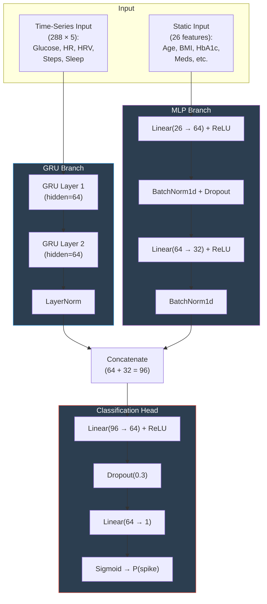
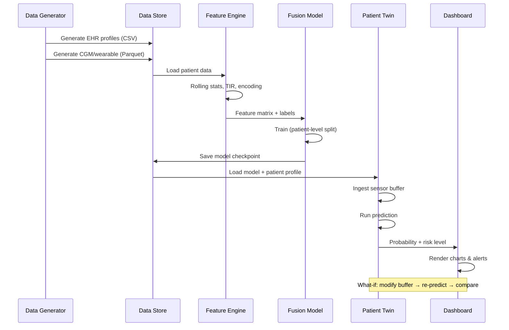

# Architecture – Digital Twin for Type 2 Diabetes

## System Overview

## Fusion Model Architecture

## Data Flow

## Key Design Decisions

| Decision | Rationale |
|----------|-----------|
| Patient-level split | Prevents data leakage (no patient in both train and test) |
| GRU over LSTM | Fewer parameters, comparable performance for this sequence length |
| 24-hour lookback | Captures circadian rhythm and dawn phenomenon |
| 2-hour prediction horizon | Actionable window for intervention |
| Weighted BCE loss | Handles class imbalance (spikes are minority class) |
| Forward-fill then zero-fill NaN | Preserves temporal continuity for GRU |
| Subsample negatives | Reduces training time while maintaining signal |
